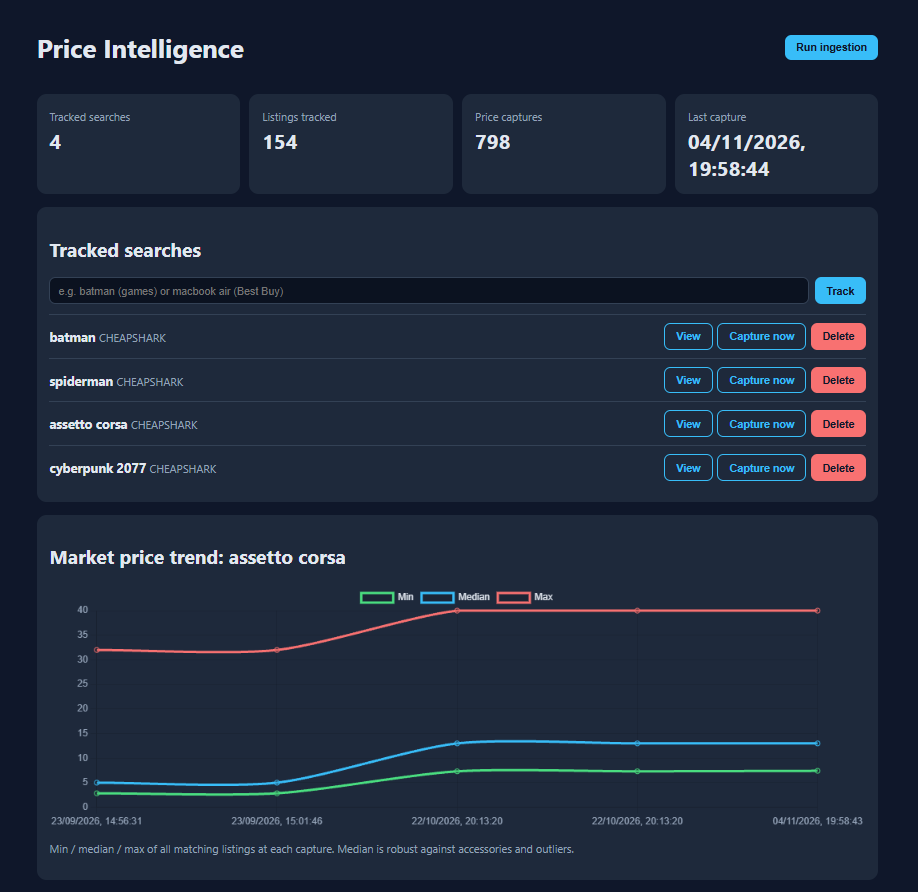
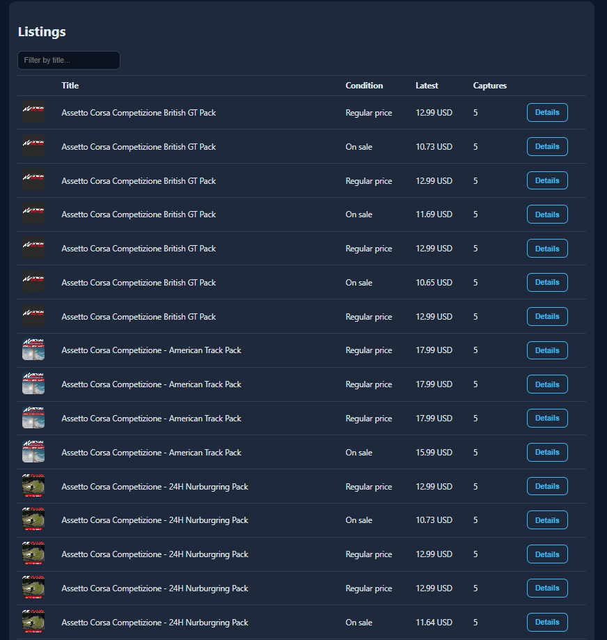

# Market Price Tracker

An automated price monitoring and analytics platform that collects product listings from multiple marketplaces, tracks price changes over time, and turns raw listing data into useful market insights.

Built with **Python, FastAPI, PostgreSQL, SQLAlchemy, Alembic, Docker, and Chart.js**.

## The Problem

Comparing prices across marketplaces manually is time-consuming, and checking a product only once does not reveal how its price changes over time.

**Market Price Tracker** automates this process by collecting matching product listings, storing historical price snapshots, and calculating market-level statistics. This makes it easier to compare offers and understand price trends instead of relying on a single point-in-time price.

## Key Features

- **Multi-source price collection** – supports CheapShark, Best Buy, and eBay as configurable data providers.
- **Automated ingestion** – collect prices manually or on a recurring schedule.
- **Historical price tracking** – store individual listing snapshots to build a price history over time.
- **Market analytics** – calculate minimum, median, average, and maximum prices, as well as listing counts for each tracked search.
- **Interactive dashboard** – manage tracked searches, inspect listings, and visualize price trends.
- **REST API** – expose application functionality and analytics through FastAPI endpoints.
- **Database migrations** – manage schema changes with Alembic.

## Screenshots

### Price Intelligence Dashboard

The dashboard provides an overview of tracked searches, listing volume, captured prices, and the latest ingestion time. It also visualizes market price trends using minimum, median, and maximum values.



### Product Listings

Browse collected listings, filter products by title, review the latest observed price and condition, and open individual listing details.



## How It Works

```text
Marketplace APIs
      |
      v
Data ingestion (manual or scheduled)
      |
      v
PostgreSQL database
      |
      v
Analytics and REST API (FastAPI)
      |
      v
Interactive dashboard (Chart.js)
```

1. Add a search term to track, such as `batman` or `iphone 15 128gb`.
2. The selected provider returns matching fixed-price product listings.
3. The ingestion process stores a price snapshot for each listing and aggregate statistics for the tracked search.
4. A background scheduler repeats ingestion at the configured interval, allowing historical price data to accumulate.
5. The dashboard presents listing information and price trends based on the collected data.

## Data Model

The application uses PostgreSQL with the following core tables:

| Table | Purpose |
|---|---|
| `tracked_queries` | Stores the search terms being monitored. |
| `products` | Stores product/listing information returned by providers. |
| `price_snapshots` | Stores historical price observations for individual listings. |
| `query_stats` | Stores aggregate statistics for each tracked search and capture. |

## Technology Stack

- **Language:** Python
- **Backend:** FastAPI
- **Database:** PostgreSQL
- **ORM:** SQLAlchemy
- **Database migrations:** Alembic
- **Frontend visualization:** Chart.js
- **Containerization:** Docker, Docker Compose
- **API documentation:** Swagger UI / OpenAPI
- **Testing:** Pytest

## Setup

### Requirements

- Docker and Docker Compose
- Python (for running the application locally)

### Run with Docker

Start the database and API:

```bash
docker compose up --build
```

### Run locally

Start PostgreSQL:

```bash
docker compose up -d db
```

Install dependencies, apply migrations, and start the API:

```bash
pip install -r requirements.txt
alembic upgrade head
uvicorn app.main:app --reload
```

### Access the application

- **Dashboard:** http://127.0.0.1:8000/dashboard/
- **API documentation:** http://127.0.0.1:8000/docs

## Configure a Price Provider

Select the data source using the `PRICE_PROVIDER` environment variable:

```env
PRICE_PROVIDER=cheapshark
```

### CheapShark

CheapShark is the default provider and does not require an API key. It provides PC game pricing from stores such as Steam, GOG, and Humble.

Example tracked searches: `batman`, `witcher`.

### Best Buy

1. Get an API key from [Best Buy Developer](https://developer.bestbuy.com/).
2. Set `PRICE_PROVIDER=bestbuy`.
3. Add your key to the environment:

```env
BESTBUY_API_KEY=your_api_key
```

### eBay

1. Create an account in the [eBay Developers Program](https://developer.ebay.com/).
2. Create a Production keyset.
3. Set `PRICE_PROVIDER=ebay`.
4. Add your credentials to `.env`:

```env
EBAY_CLIENT_ID=your_client_id
EBAY_CLIENT_SECRET=your_client_secret
```

Use `.env.example` as the starting point for your local environment configuration. Do not commit real API credentials.

## Automated Data Collection

The background scheduler runs ingestion at the interval configured by `INGEST_INTERVAL_MINUTES` (default: `360` minutes / 6 hours).

You can also trigger ingestion manually from the dashboard.

## Tests

Run the test suite with:

```bash
pytest
```

## Future Improvements

Potential areas for further development include user accounts, configurable price-drop alerts, additional marketplace integrations, and deployment with a production monitoring setup.
